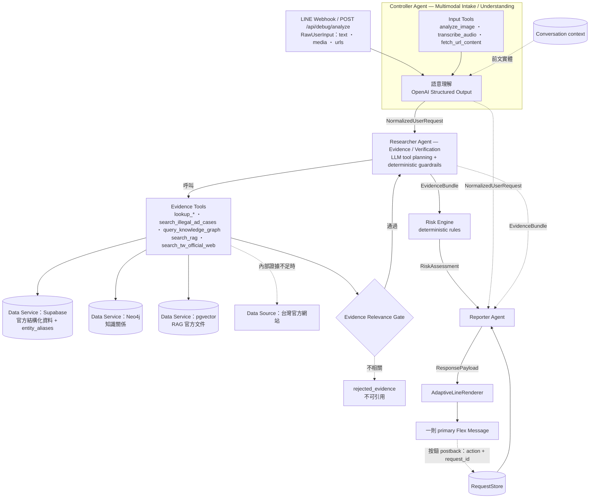

# 呷安心

> 基於 Multi-Agent 協作架構之保健食品安全辨識平台（Phase 1：僅台灣 / TW）

## 專案目的

1. 把保健食品的官方資訊（許可證、成分、核准功效、警語）整理成一般人與長者看得懂的白話繁體中文。
2. 協助查證網路、廣告、轉傳訊息裡的保健食品說法，**是否有台灣官方證據支持**，而不是靠 AI 常識回答。
3. 以 LINE Official Account 作為主要介面，降低使用門檻。

## 架構



* **Agent** 決定現在該做什麼；**Tool** 是 Agent 實際呼叫的 function interface；
  **Data Service / Data Source**（Supabase、Neo4j、pgvector、官方網站）只存資料，不是 Agent。
* Controller Agent 只能用 Input Tools，Researcher Agent 只能用 Evidence Tools，兩組互不共用；
  Reporter Agent 與 Renderer 不呼叫任何 Tool（[tests/unit/test_tool_boundaries.py](tests/unit/test_tool_boundaries.py) 檢查）。

### 三個 Agent 的責任

> 命名：Controller Agent（原 Agent A）、Researcher Agent（原 Agent B）、Reporter Agent（原 Agent C）。
> 目前只是文件用語；程式的 class、檔名、logger、enum 等識別字（`IntakeAgent`、`VerificationAgent`、`ReporterAgent`、`agent_a` 等）維持不變。
> Controller Agent 負責理解並準備查證任務，不取代 deterministic 的流程編排、Risk Engine 與 guardrails。

- **Controller Agent**：理解多模態輸入、意圖、產品 / 宣稱語意，並準備查證任務。
- **Researcher Agent**：透過受控工具（Supabase、Neo4j、RAG、官方網站 fallback）取得並查證證據。
- **Reporter Agent**：把已查證的結構化證據轉成給使用者的回覆，不產生新證據。

| Agent | 做什麼 | 不做什麼 |
|---|---|---|
| Controller Agent（原 Agent A）— Multimodal Intake（[app/agents/intake_agent.py](app/agents/intake_agent.py)） | 圖片 / 語音 / 網址先用 Input Tools 轉成文字（文字輸入不需要 Tool），再走**同一段**語意理解，輸出唯一的 `NormalizedUserRequest`：意圖、實體候選、命題語意分類與 **statement role**；用對話 context 解析「它 / 這個」 | 不回答問題、不查資料庫、不判斷風險；不為 image / audio / URL 各建一套 pipeline；前文解析只能選系統提供的實體 |
| Researcher Agent（原 Agent B）— Evidence / Verification（[app/agents/verification_agent.py](app/agents/verification_agent.py)） | **Hybrid tool planning**：LLM 以 function calling 在 allowlist 內規劃工具（可多輪）；deterministic guardrails 補齊必要查證；證據經 Relevance Gate 篩選後組成 `EvidenceBundle` | 不能呼叫 allowlist 外的工具、不能編造 ID、不能自行決定查官方網站；證據由程式收集，LLM 只評估相關性與命題關係 |
| Reporter Agent（原 Agent C）（[app/agents/reporter_agent.py](app/agents/reporter_agent.py)） | 輸出結構化 `ResponsePayload`（依 intent 選 response_type）；按鈕觸發時依同一 request_id 的證據產生 `DetailPayload`（只有「查看完整分析」用 LLM 寫白話正文） | 不輸出 Flex JSON、不重新查資料、不新增證據裡沒有的官方結論、不改變風險等級 |

所有 LLM 指令集中在 [app/agents/prompts.py](app/agents/prompts.py)。

### Statement role（使用者提問 ≠ 產品 / 廣告宣稱）

每個命題都有 `origin`：`USER_QUESTION`、`USER_ASSERTION`、`PRODUCT_LABEL_CLAIM`、`ADVERTISEMENT_CLAIM`、`THIRD_PARTY_CLAIM`、`OFFICIAL_CLAIM`。

- `USER_QUESTION`（例如「這個可以治療某病嗎？」）只是待查證的命題。醫療語意只會觸發查證並附上醫療免責說明，不會被當成產品已經做出的宣稱。
- 只有 `PRODUCT_LABEL_CLAIM` / `ADVERTISEMENT_CLAIM`（有包裝或廣告證據）的醫療效能宣稱，才會讓風險變成 HIGH。
- 使用者斷言、轉傳說法最多是 MEDIUM。
- 「它 / 這個」：先用對話 context 解析（`conversation_id`）。解析不到就標記 `MISSING_CONTEXT`，風險 MEDIUM、不下定論。

### Researcher Agent 的 guardrails（deterministic）

| Guardrail | 實作 |
|---|---|
| Tool allowlist | [evidence_tools.py](app/agents/evidence_tools.py) 的 `EVIDENCE_TOOLS` / `OFFICIAL_WEB_TOOLS`；allowlist 外的名稱直接拒絕 |
| 參數驗證 | 每個工具有 pydantic schema（strict JSON schema）；格式錯誤會拒絕 |
| ID 來源 | product / ingredient ID 必須來自先前工具結果或已查證的前文 |
| 次數上限 | 每次最多 4 輪、每輪 6 個、總共 14 個 call，時間預算 90 秒；重複呼叫會被略過 |
| 必要查證 | planner 漏掉的產品查詢、核准功效、RAG、違規廣告由 guardrail 補做（`planned_by=guardrail`） |
| 官方網站 | 由程式判斷內部證據不足才開放，planner 只決定查詢語句，最多查 1 次；網域 allowlist 會再檢查一次 |
| Relevance Gate | RAG / 官方網站證據必須 `relevance_score ≥ 0.6` 且 scope 不是 `UNRELATED`（`GENERAL_BACKGROUND` 需 ≥ 0.8）；沒有通過或沒有評估的證據放進 `rejected_evidence`，Reporter 不能引用 |
| 失敗處理 | planner 失敗時改用 deterministic fallback；資料來源或證據評估失敗會如實列在 `errors` |
| Phase 1 | 只查台灣；工具不開放 country 參數 |

### Tools

每個 Tool 輸入明確、輸出結構化，可單獨測試，不產生最終回答。

**Controller Agent — Input Tools**（[input_tools.py](app/tools/input_tools.py)）

| Tool | 做什麼 |
|---|---|
| `analyze_image` | OpenAI 圖片理解：照抄圖片中的文字並描述包裝 / 廣告，不判斷真假 |
| `transcribe_audio` | OpenAI 語音轉文字 |
| `fetch_url_content` | 讀取使用者提供網址的正文；只允許 http(s) 與公開 IP（每次重新導向都重新檢查），非官方網頁標註「只代表對方宣稱」 |

**Researcher Agent — Evidence Tools**

| Tool | 檔案 | Data Service / Source |
|---|---|---|
| `lookup_product` / `lookup_permit` / `lookup_company` / `lookup_ingredient` | [product_tools.py](app/tools/product_tools.py) | Supabase |
| `lookup_approved_claim` / `lookup_product_warnings` / `lookup_product_ingredients` | 同上 | Supabase |
| `search_illegal_ad_cases` | 同上 | Supabase（資料表已建，尚未匯入資料） |
| `resolve_entity_alias` | 同上 | Supabase `entity_aliases`（品牌→申請商、公司簡稱、成分英文名） |
| `query_knowledge_graph` | [graph_tools.py](app/tools/graph_tools.py) | Neo4j（只允許固定、參數化的查詢類型） |
| `search_rag` | [rag_tools.py](app/tools/rag_tools.py) | OpenAI embedding + pgvector |
| `search_tw_official_web` | [official_web_tools.py](app/tools/official_web_tools.py) | OpenAI web_search，限 `fda.gov.tw`、`data.fda.gov.tw`、`mohw.gov.tw`、`data.gov.tw` 及其子網域；程式會再檢查一次網域 |

## 回覆架構（Adaptive LINE Response）

* **每個 request 只有一則 primary response**：一張簡潔的 Adaptive Flex Message。不自動補發長文、來源或第二則訊息。
* **Reporter Agent 與 Renderer 分離**：Reporter Agent 輸出 [`ResponsePayload`](app/schemas/response.py)
  （`request_id`、`response_type`、`risk_level`、`title`、`summary`、`key_points`、`warnings`、`available_actions`、`source_count`、`sources`）；
  [AdaptiveLineRenderer](app/response/line_renderer.py) 才轉成 Flex。payload 可以比卡片完整，UI 不限制 Reporter Agent 的內容。
* **Adaptive template**：`RISK`、`PRODUCT_INFO`、`INGREDIENT_LIST`、`CLAIM_RESULT`、`SOURCE_SUMMARY`、`MISSING_INFORMATION`、`OUT_OF_SCOPE`、`ERROR`。
  只有 `RISK` 顯示 🟢 LOW / 🟠 MEDIUM / 🔴 HIGH；高風險或包裝 / 廣告宣稱一律用 RISK，不會被其他 template 隱藏。
* **卡片內容**：結果、一句結論、最多 3 個重點、必要警語、最多 3 個按鈕；白色 / 中性色，不使用大面積色塊。
* **On-demand 按鈕**：查看完整分析、查看資料來源、查看完整成分、查看官方資訊、為什麼？、重新查詢。
  只有按下後才產生內容（完整分析才呼叫 LLM）。
* **Request-scoped actions**：postback data 一律是 `action=<action>&request_id=<uuid>`（[actions.py](app/response/actions.py)）。
  按舊題目的按鈕會依該 request_id 取回那一題的結果，並確認是同一位使用者；不依最新 conversation state 猜測。
* **不延遲補發**：[AdaptiveResponseService](app/response/service.py) 有時限；逾時立即回 ERROR card（附「重新查詢」），
  背景晚完成的結果直接丟棄，不送出、也不覆蓋該 request_id 的紀錄。
* RequestStore 目前是 in-memory（24 小時 / 2000 筆），多 instance 上線前需改為 Supabase。

## 資料分工

### Supabase（canonical source of truth）

[migrations/0001_initial_schema.sql](migrations/0001_initial_schema.sql)

- 來源追蹤：`source_registry`、`raw_import_records`（原始 JSON 完整保存）
- 官方結構化資料：`companies`、`permits`、`products`、`ingredients`、`product_ingredients`、`warnings`、`product_warnings`
- 宣稱分三類存放，不混在同一個欄位：
  - 官方核准功效：`approved_claims`（功效類別）＋ `product_claims`（產品核准原文）
  - 使用者 / 廣告宣稱：`observed_claims`
  - 違規廣告證據：`illegal_ad_cases`
- RAG：`rag_documents`、`rag_chunks`（`vector(1536)`、HNSW cosine index）、`match_rag_chunks()`
- 使用者與紀錄：`line_users`、`analysis_requests`、`evidence_logs`
- `app_schema_meta`：schema marker。程式只會對有 `project = nutri_safe_ai` marker 的 DB 讀寫
- 全部資料表都開啟 RLS 且沒有 policy，只有 service role（後端）能存取

### Neo4j（只存知識關係）

[migrations/neo4j/0001_constraints.cypher](migrations/neo4j/0001_constraints.cypher)

```
(Company)-[:OWNS_OR_APPLIES_FOR]->(Product)
(Product)-[:CONTAINS {raw_text}]->(Ingredient)
(Product)-[:REGISTERED_AS]->(Permit)
(Product)-[:HAS_APPROVED_CLAIM {claim_text}]->(Claim)
(Product)-[:HAS_WARNING]->(Warning)
(Product)-[:SUPPORTED_BY]->(Source)
(Claim)-[:SUPPORTED_BY]->(Source)
(Company)-[:OWNS_BRAND]->(Brand)              # 只限有 ownership evidence 的官方 / 人工審核品牌
(Company)-[:ASSOCIATED_WITH_BRAND]->(Brand)   # 有關聯但未確認擁有（例如由產品名稱推導）
(Product)-[:HAS_BRAND]->(Brand)
```

`OWNS_BRAND`、`ASSOCIATED_WITH_BRAND` 與 `HAS_BRAND` 都帶 `confidence`、`evidence_status`、`is_inferred`、`inference_basis`。由產品名稱推導出的品牌一律標成 `is_inferred = true`。

公司與品牌的關係以 Supabase `brands.company_relation` 為準：TFDA 資料沒有品牌欄位，由產品名稱推導的品牌只能是 `ASSOCIATED_WITH_BRAND`（有關聯，不代表官方確認擁有）。只有 `OFFICIAL_RECORD` / `MANUAL_REVIEWED` 且附上 `ownership_evidence` 的品牌才會是 `OWNS_BRAND`（資料庫 check constraint 保證）。一家公司可以有 0..N 個品牌。

節點和 Supabase 共用 canonical UUID（由 `uuid5` 依自然鍵產生）。圖譜一律由 Supabase 同步產生（[app/ingestion/graph_sync.py](app/ingestion/graph_sync.py)），Neo4j 不另外維護產品主檔。

### Entity Alias

[migrations/0001_initial_schema.sql](migrations/0001_initial_schema.sql)、[app/ingestion/alias_builder.py](app/ingestion/alias_builder.py)

`brands`、`product_brands`、`entity_aliases(entity_type, product_id | brand_id | company_id | ingredient_id → entity_id, alias, alias_normalized, alias_type, source_id, confidence, evidence)` 支援 PRODUCT / BRAND / COMPANY / INGREDIENT。每一列只會指向一個實體，並且有 FK 保證這個實體存在。別名全部由官方資料以可重現的規則產生，不含人工指定的品牌：

- 公司簡稱：去掉組織型態（股份有限公司、外商前綴…）
- 成分英文名：取自官方成分欄位
- 品牌：同一家申請商多項產品共用的名稱前綴，經 brand quality gate 分成 ACCEPTED / REVIEW_CANDIDATE / REJECTED，只有 ACCEPTED（或人工審核）會寫入。一家公司可以有 0..N 個品牌：互為前綴的候選（X、XY）只是同一品牌的不同邊界，取最佳者；不同前綴的候選各自通過 gate，可同時採用
- 推導品牌一律 INFERRED，與公司的關係是 `ASSOCIATED_WITH_BRAND`，不是官方確認的擁有關係
- **推測不是官方確認**：每一筆品牌、產品品牌歸屬、別名都有 `evidence_status`（`OFFICIAL_RECORD` / `INFERRED` / `MANUAL_REVIEWED`）
  - 只有英文成分名屬於 `OFFICIAL_RECORD`（直接取自官方欄位）
  - 品牌前綴推導、公司簡稱都屬於 `INFERRED`
  - DB constraint 規定 `INFERRED` 必須有 `inference_basis`，而且 `confidence < 1`
- 推測出來的關聯會放進 `EvidenceBundle.inferred_links`，SourceRef 標成 `derived_inference` 且 `is_official = false`
- Reporter 遇到推測關聯時，一定會附上「品牌與公司之間的對應是系統依產品名稱推測的，並非官方確認」。如果 LLM 正文出現「官方確認」這類字眼，就改用固定模板

### RAG

只用在非結構化的官方文字（法規、指引）。精確欄位（例如許可證字號）一律走 SQL。目前的 seed 文件是食藥署網站上的《健康食品管理法》全文。

## 風險邏輯

[app/risk/assessment_rules.py](app/risk/assessment_rules.py)、[app/risk/risk_engine.py](app/risk/risk_engine.py)

先分開判斷三件事，最後才由 deterministic 規則合成 LOW / MEDIUM / HIGH。LLM 只負責語意分類，不決定風險等級。

1. **Product Verification**：`VERIFIED`（許可證字號命中或名稱分數 ≥ 0.9）／`PARTIAL_MATCH`（≥ 0.5 或只確認到公司）／`NOT_FOUND`／`CONFLICT`（字號對應的產品和使用者說的名稱不一致）／`NOT_APPLICABLE`
2. **Claim Assessment**：醫療效能 → `MEDICAL_TREATMENT_CLAIM`；與官方矛盾 → `CONFLICT_WITH_OFFICIAL`；絕對化用語或超出核准範圍 → `POTENTIALLY_EXAGGERATED`；被該產品的核准功效支持 → `CONSISTENT_WITH_OFFICIAL`；資料來源全部失敗 → `UNKNOWN`；其他 → `UNSUPPORTED`
3. **Evidence Strength**：`STRONG`／`MEDIUM`／`WEAK`／`NONE`

| 等級 | 規則（任一命中即成立，取最高等級） |
|---|---|
| HIGH | **包裝 / 廣告**宣稱醫療效能或與官方矛盾、產品資訊矛盾、官方違規廣告紀錄相符 |
| MEDIUM | 查無官方紀錄、只部分符合、許可證非有效、包裝 / 廣告宣稱誇大或無官方支持、流傳說法不正確、證據不足、無法確認指的是哪項產品、查詢失敗 |
| LOW | 產品已確認、沒有被說出的不當宣稱、證據 STRONG/MEDIUM（或屬於一般資訊查詢且有官方證據）；使用者提問的查證結果不影響產品風險 |

重要原則：

- `NOT_FOUND` 不等於假貨。回覆一定附上「目前未找到官方紀錄，不代表產品一定是假貨或違法。」
- 「查詢失敗」和「查無紀錄」分開處理（`lookup_completed`），系統不會在查詢失敗時說查無紀錄。
- 已登記的產品，也可能因為不當宣稱被判為 HIGH。

## 環境變數

見 [.env.example](.env.example)。`.env` 已列在 `.gitignore`，不可 commit。

| 變數 | 用途 |
|---|---|
| `OPENAI_API_KEY` `OPENAI_MODEL` `OPENAI_TRANSCRIPTION_MODEL` `OPENAI_EMBEDDING_MODEL` | OpenAI |
| `SUPABASE_URL` `SUPABASE_SECRET_KEY` | nutri_safe_ai 專用 Supabase project。URL 只能是 `https://<project-ref>.supabase.co`（不可加 `/rest/v1`）。key 必須是後端 secret key（`sb_secret_` 開頭），不再使用 legacy `SUPABASE_SERVICE_ROLE_KEY`。格式錯誤時啟動會直接失敗，錯誤訊息不會帶出 key 的內容 |
| `NEO4J_URI` `NEO4J_USERNAME` `NEO4J_PASSWORD` `NEO4J_DATABASE` | 呷安心專用 Neo4j instance |
| `LINE_CHANNEL_SECRET` `LINE_CHANNEL_ACCESS_TOKEN` | LINE Messaging API |
| `APP_ENV` | `production` 時會關閉 debug endpoint |

## 本機啟動

```powershell
.\.venv\Scripts\python.exe -m pip install -r requirements.txt

# 1) Supabase：在「新的」project 的 SQL Editor 執行 migrations/0001_initial_schema.sql（單一檔案，可重複執行）
# 2) Neo4j：在「新的」instance 建立 constraints 與 schema marker
.\.venv\Scripts\python.exe -m scripts.setup_neo4j
# 3) 匯入少量台灣官方資料（先 dry-run 確認）
.\.venv\Scripts\python.exe -m scripts.seed_tw_official_data --dry-run
.\.venv\Scripts\python.exe -m scripts.seed_tw_official_data --limit 50
# 4) 啟動 API
.\run_dev.ps1
```

Debug API（只在非 production 開放）：

```powershell
curl -X POST http://127.0.0.1:8000/api/debug/analyze -H "Content-Type: application/json" `
     -d '{"type":"text","content":"吃這個可以治療糖尿病嗎？","conversation_id":"demo-1"}'
```

同一個 `conversation_id` 會帶入前文（目前存在記憶體中），用來解析「它 / 這個」。

debug endpoint 接受 `text` 與 `url`（image / audio 需要二進位內容，由 LINE channel 傳入）。
回傳 `request_id`、`normalized_request`、`tools_called`、`product_verification`、`evidence`、`claim_assessment`、`risk`、`response`（ResponsePayload）、`final_answer`（response 的純文字版，只供 debug）、`errors`。

## 測試

```powershell
.\run_tests.ps1                              # 全部
.\.venv\Scripts\python.exe -m pytest tests/unit   # 只跑離線測試
.\.venv\Scripts\python.exe -m pytest -m integration -s -rs   # 只跑外部服務測試
.\.venv\Scripts\python.exe -m pytest tests/db               # 在本機空白 PostgreSQL 驗證 migration（需 requirements-dev.txt）
```

- `tests/unit`：fake LLM 加上 in-memory 的 **TEST_ONLY** synthetic 資料（[tests/fixtures/synthetic_data.py](tests/fixtures/synthetic_data.py)），不需要任何 credentials。
- `tests/integration`：會真的呼叫 OpenAI / Supabase / Neo4j。缺少 credentials，或連到的不是 nutri_safe_ai DB 時，會以 `SKIPPED_EXTERNAL: 原因` 標示 skip。
- synthetic 資料只存在 `tests/` 中，不可匯入正式資料庫。

## LINE webhook 設定（下一階段）

1. LINE Developers Console → Messaging API → Webhook URL 設為 `https://<你的網域>/api/line/webhook`，並開啟 Use webhook。
2. 關閉自動回應訊息。
3. 在 `.env` 填入 `LINE_CHANNEL_SECRET`、`LINE_CHANNEL_ACCESS_TOKEN`。
4. webhook 會驗證 `X-Line-Signature`，再呼叫與 debug endpoint 相同的 pipeline。

## 目前限制

- Input Tools 與回覆架構（contract、Renderer、request-scoped actions）已完成；LINE webhook（簽章驗證、下載 LINE 圖片 / 語音內容、reply API）尚未實作。
- 正式 DB 目前只有 TFDA「健康食品資料集」（InfoId 19）。國產維生素類錠狀／膠囊狀食品（InfoId 24）與輸入錠狀／膠囊狀食品（InfoId 23）
  的 importer、runtime 類別感知與 `migrations/0004_tfda_product_coverage.sql` 已就緒但尚未套用 / 匯入
  （研究 snapshot：`data/tfda_product_coverage/2026-10-04/`）。一般食品、違規廣告等資料集尚未匯入，因此 `illegal_ad_cases` 目前是空的。
- Claim policy corpus：`data/tfda_claim_policy/2026-10-03/`（`python -m scripts.import_claim_policy_corpus --dry-run`）。
- 資料完整性：`python -m scripts.check_data_integrity`（唯讀；依來源 / 批次 / 類別驗證，可加 `--expect-category <類別>=<筆數>`）。
- 成分欄位的官方格式很不一致，parser 採保守的通用規則。少數品管指標（例如「魚油純度」）會被當成成分，原文完整保留在 `product_ingredients.raw_text`。
- 產品名稱比對是字元層級的相似度。只講俗稱（例如只有品牌加品類）時，通常只會得到 `PARTIAL_MATCH`。
- 官方網站 fallback 有時會回傳相關性偏低的官方頁面（例如檢驗結果清單），還需要加上相關性篩選。
- 只處理台灣資料。提到外國產品時，會附上「第一階段只以台灣官方資料查證」的說明。
- 對話 context 目前存在記憶體中（重啟會消失、不能跨 process），LINE 階段要改成持久化。
- 每次查證會呼叫 LLM 多次（planner 1~4 輪＋證據評估 1~2 次＋回覆），延遲大約 20~40 秒，需要再優化。
