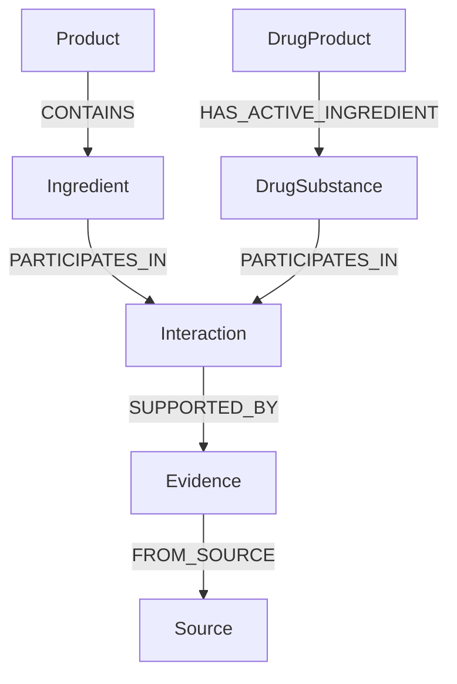

# Ingredient Interaction Evidence Corpus — 台灣平台第一版

研究基準：2026-10-04；corpus_version=1.0；retrieved_at採UTC ISO-8601。這是限定範圍、可追溯的研究整理，不是全球完整interaction checker，也不是已完成正式GRADE／risk-of-bias評估的系統綜述。未修改應用程式、GitHub、Supabase、Neo4j、RAG或production，未建立DrugProduct或Product↔Product直接交互作用。

## 1. 成果範圍與計數

共有45個實體（包括營養素群、鹽型／vitamer／混合物及15個drug substances）、86個別名、42條records、60筆evidence、39個來源。其中25條是臨床／生理配對，17條是DUPLICATE_INTAKE模板；不是42種已確定有害交互作用。
42條均有外國或台灣官方evidence，台灣官方evidence支持的配對1條（魚油-warfarin，僅保留衛教及產品警語的適用範圍）。8條配對另外有PubMed研究；共12個不同PMID。官方來源數不能當證據品質分數。

| evidence_use | Evidence列數 | Record列數 |
|---|---:|---:|
| DECISION_ELIGIBLE | 29 | 29 |
| SUPPORTING | 26 | 9 |
| CONTEXT_ONLY | 5 | 3 |
| NEEDS_REVIEW | 0 | 1 |

EVIDENCE_CONFLICT配對1條；record層需review共10條，包含該衝突。另15個drug substances的台灣成分代碼mapping均標NEEDS_REVIEW，並非已有台灣藥品許可或完整中文成分對照。READY只表示此結構化紀錄可供設計／審查，沒有宣稱醫療專家已驗證。

## 2. 來源優先與取得方式

Tier A先查TFDA、MOHW/HPA、台灣藥品metadata與官方健康食品警語。三個藥品資料集只盤點；未下載全量藥品產品。TFDA健康食品JSON僅用於選定產品警語，不採其中功效為interaction證據。Tier B取得17份NIH ODS health professional fact sheets、NCCIH Omega3頁、FDA2026 dolutegravir仿單；EFSA只為釐清B6上限的國別差異加入。Tier C先查系統綜述／meta，再納人體PK、RCT、observational及一個重要case report反映衝突。

PubMed使用NLM EFetch全量摘要／metadata核對PMID、DOI、publication types及日期；各result_summary_zh為自行摘要。交付pubmed_metadata.json不包含整篇論文或完整學術摘要。PubMed索引機關是NLM，但論文結果的authority是研究作者，source_tier=C，不能因nih.gov而升為政府臨床核准。舊RCT的PubMed類型可能僅Journal Article，本版study_type依摘要實際design補充，原始publication_types_json仍保留。

沒有商業interaction checker、電商、部落格或一般健康網站作core evidence。TFDA衛教本身有二手參考文獻，所以仍只作SUPPORTING，未因政府網站發表而視為確定因果證據。EFSA原始官方URL導向其官方panel在Wiley期刊的科學意見，這不是商業checker，僅取該官方評估的UL與版本，未抄全文。

## 3. 成分涵蓋與identity層級

| 本版範圍 | Entity ID | 配對或duplicate record數 |
|---|---|---:|
| Calcium | N_CA | 5 |
| Iron | N_FE | 8 |
| Magnesium | N_MG | 4 |
| Zinc | N_ZN | 5 |
| Copper | N_CU | 2 |
| Vitamin D | N_D | 4 |
| Vitamin K | N_K | 2 |
| Vitamin C | N_C | 2 |
| Thiamin | N_B1 | 1 |
| Riboflavin | N_B2 | 1 |
| Niacin | N_B3 | 1 |
| Pantothenic acid | N_B5 | 1 |
| Vitamin B6 | N_B6 | 1 |
| Biotin | N_B7 | 1 |
| Folate | N_B9 | 1 |
| Vitamin B12 | N_B12 | 3 |
| Omega-3 fatty acids | N_OMEGA3 | 1 |

N_前綴是NUTRIENT_GROUP，不是假裝已確定化學substance。F_前綴保存魚油混合物、EPA、DHA、D2、D3、folic acid、pyridoxine、nicotinic acid及特定鈣／鐵鹽；D_前綴為drug active moiety或已明確的salt。魚油≠Omega3≠EPA≠DHA；folate營養素群≠folic acid；calcium營養素群≠calcium carbonate／citrate／acetate。D_DTG與D_DTG_SODIUM分開，FDA仿單描述每錠dolutegravir以sodium形式存在，其parent_active_moiety_id只保存關聯，不以移除sodium字串來猜化學等同。CAS、UNII、InChIKey、RxNorm及TFDA成分代碼未逐項核對則NULL，不用模型記憶補入。

English canonical names與具來源的同義名／EPA等縮寫允許在指定identity level精確比對；中文display translations只作呈現與候選，不用中文相近、品牌或產品名稱直接合併chemical substances。source_id可追溯每個entity／alias。B1、B2、B5未建立有害pair，只有duplicate/reference範圍；ODS的「未見已知clinically relevant interaction」不等於對所有配方、劑量與族群已證明無interaction。Biotin還有檢驗干擾背景，本版不把lab assay當DrugSubstance硬建配對。

## 4. Records與Evidence的使用語意

| 欄位 | 用法 |
|---|---|
| interaction_type | ABSORPTION等臨床／生理配對；DUPLICATE_INTAKE另分 |
| directionality | A_AFFECTS_B、B_AFFECTS_A、SELF_ACCUMULATION，不以輸入順序推機轉 |
| severity | 潛在結果的研究整理，不是來源官方severity評分，也不是發生機率 |
| certainty | HIGH/MODERATE/LOW/CONTEXT_DEPENDENT/CONFLICTING，與severity分開 |
| evidence_level | 官方label／官方摘要、human PK/RCT/observational、case report等，不冒充正式GRADE |
| evidence_use | 可納判斷、輔助、背景、或待審；不等於每條可硬寫warning |
| supports_direction | SUPPORTS、NO_SIGNIFICANT_EFFECT、MIXED_ENDPOINTS等結果方向，不是A/B方向欄 |
| applicability_conditions | 製劑、食物、劑量、期間、族群、適應症等條件 |
| decision_mode | 指定條件訊息、需label核對、背景、衝突說明、或只做重複攝取 |
| review_status | READY / NEEDS_REVIEW / EVIDENCE_CONFLICT |

DECISION_ELIGIBLE是證據可以在滿足applicability條件時參與訊息或已驗證計算，不是無條件醫療決策授權。查到配對還必須確認精確ingredient／active ingredient、口服route、製劑、劑量、族群、用藥適應症、服用時間與來源版本。缺資訊要回NEEDS_REVIEW；不能因severity=POTENTIALLY_MAJOR把低證據變「確定高風險」。本版沒有animal／in-vitro單獨支撐deterministic warning。部分人體研究附in-vitro component，只讓臨床結果作主要支持、機轉保持「可能」。沒有明確機轉的records保留NULL。

## 5. 重要配對、條件與Demo候選

| 配對 | 第一版適用說明 | 自動化界限 |
|---|---|---|
| 鈣／levothyroxine | 碳酸鈣同服吸收可能下降；ODS引用4h避開 | 需確認鹽型與實際仿單；不能所有甲狀腺藥都套 |
| 鐵／levothyroxine | 同服可能降低療效；部分label要求4h | 300mg ferrous sulfate是鹽重量，不是300mg元素鐵 |
| 鈣或鐵／dolutegravir | 空腹先2h／後6h；TIVICAY隨餐有例外 | 只將確定TIVICAY tablet條件用於自動訊息；PD按實際仿單review |
| 鋅／銅 | ≥50mg/day元素鋅持續數週的來源風險情境 | 正常劑量同用不可說必然缺銅，需劑量與期間 |
| Vitamin K／warfarin | 維持攝取一致，突然變動可能改變INR | 不是全面禁吃K，也不能套所有DOAC |
| 鋅／鋅，鈣／鈣 | 共同成分→合計每日攝取 | 重複不等於超UL或INTERACTS_WITH |
| 魚油／warfarin | 個案正訊號、小RCT與cohort未見整體顯著影響 | EVIDENCE_CONFLICT，展示正反證據及需監測，不能確定出血 |
| Vitamin C／鐵 | 可促進nonheme吸收；IDA試驗鐵單用與加C等效 | 生理促進≠必須補C；CONTEXT_ONLY，不是有害warning |

建議最先Demo：鈣／levothyroxine、鐵／levothyroxine、Vitamin K／warfarin、鋅／鋅duplicate及魚油／warfarin衝突；加入dolutegravir時展示fed/fasted及劑型條件，避免只有通用時距。所有Demo只用成分與藥品有效成分，可由查到的產品CONTAINS關係推導，不建立Product↔Product直接edge。

### dolutegravir仿單核對

FDA2026-08版本的section7.3表格（PDF/印刷第15頁，ReferenceID5858277）對空腹TIVICAY/TIVICAY PD給先2h／後6h，隨餐例外在表格寫TIVICAY；patient information同時提TIVICAY與PD。本版保留此措辭差異，不用模型把兩段硬合成所有PD劑型通用規則。已渲染及查看第15頁；精確timeline不可只用ODS較概括的時距而忽略FDAfed例外。

### 鈣／鐵與Vitamin C／鐵不是同類「衝突」

鈣／鐵meta顯示短期吸收下降，但Hb未下降且長期指標混合，因此record NEEDS_REVIEW，不普遍強制隔幾小時。C促進吸收與RCT「並非必須额外加C才能改善IDA」是不同outcome／情境，不能機械標EVIDENCE_CONFLICT。Methotrexate則分癌症與低劑量RA／psoriasis兩條context，不能一條說folate全部禁止，也不能把folinic acid救援醫囑當危險配對。

## 6. 魚油-warfarin正反證據

| PMID或官方來源 | Study / n | 結果與限制 |
|---|---|---|
| 14742793 | case report / 1 | 魚油1→2g/day後INR升；無對照，無法估機率／通用threshold |
| 10767122 | 雙盲RCT / 16 | 魚油3或6g/day四週未見INR顯著差異；5人退出，樣本小 |
| 27657121 | retrospective / 573 | 145魚／磷蝦油使用者與428對照TTR及出血無顯著差異；混雜及配方不一 |
| ODS Omega3 | 官方整理 | 並列可能增加INR及多數研究未見显著效果，提醒監測 |
| TFDA衛教與選定產品警語 | 官方caution / product-specific | 保留預先諮詢醫師及個別許可警語；不從這裡推所有魚油的因果強度 |
| 38742535 | meta / 120643、11RCT | 整體Omega3出血RR1.09不顯著；高量純EPA子分析绝對風險約增0.6%；不是warfarin專屬INR研究，只作CONTEXT_ONLY |

record review_status=EVIDENCE_CONFLICT、certainty=CONFLICTING、evidence_use=NEEDS_REVIEW。兩個不同量魚油不能比較成一致EPA+DHA暴露；陰性結果不是證明安全，個案亦不是普遍因果。官方高品質衛教只支持詢問／監測，沒有選一篇研究當唯一答案。evidence_use各列保持其可用程度；冲突是在record整合層阻止確定結論，不刪除原始結果方向。

## 7. Duplicate intake與cumulative intake

17個DUP records都是相同nutrient group的SELF_ACCUMULATION模板。它們不是臨床藥物交互作用，不產生INTERACTS_WITH。兩個產品的份數及成分已驗證後，對同一基準合計daily amount；僅有共同成分就只能提示「重複攝取」，沒有劑量不能宣稱過量。product原始成分或包裝上同時列複方與其內含營養素時，要以amount lineage避免把主料與子料重複算兩次；source未明確時不得重建假的BOM。

必要輸入：每日份數、每份量、單位、原料amount basis（元素量／鹽重量／活性量）、化學形態、攝取期間、年齡／孕哺／腎病及適用jurisdiction。計算可重現，但amount extraction／canonicalization未確認時不能自動做。魚油總重與EPA+DHA不能相加當同一重量；鈣與鐵鹽重量不能直接等於元素量；D的IU換算需先確認vitamer及來源量基準；folic acid重量與DFE不能直接相加；niacin、nicotinic acid、nicotinamide及NE也需分開。

UL與RDA不同；RDA不是超量警告切點。成人US FNB上限若有填，保留於dose_context JSON明示US_REFERENCE_ONLY；鎂只包括supplements/medications而非一般食品鎂，folic acid不包括自然食物folate。沒有UL的B1/B2/B5/B7/B12/K及本版未填Omega3數值時，不把NULL讀成0或∞，也不寫「無限量安全」。美國B6 UL100mg/day與EFSA2023 EU12mg/day分國別保存，這是版本／jurisdiction差異，不以最方便值取代台灣DRIs。台灣DRIs PDF及UL CSV擷取502／timeout，因此沒有任何台灣自動超UL判斷；待官方附件可取得後加入完整族群表及版本。

## 8. 台灣藥品資料集inventory與canonicalization

| Dataset | ID / InfoId | 欄位 | 更新頻率／metadata |
|---|---|---|---|
| 全部藥品許可證資料集 | 9122 / 36 | 許可證字號、註銷狀態、註銷日期、註銷理由、有效日期、發證日期、許可證種類、舊證字號、通關簽審文件編號、中文品名、英文品名、適應症、劑型、包裝、藥品類別、管制藥品分類級別、主成分略述、申請商名稱、申請商地址、申請商統一編號、製造商名稱、製造廠廠址、製造廠公司地址、製造廠國別、製程、異動日期、用法用量、包裝與國際條碼 | 每7日 / 2026-09-15 07:48 |
| 藥品詳細處方成分資料集 | 9121 / 43 | 許可證字號、處方標示、成分名稱、成分代碼、含量描述、含量、含量單位 | 每7日 / 2026-09-24 10:58 |
| 藥品仿單或外盒資料集 | 9117 / 39 | 許可證字號、中文品名、英文品名、仿單圖檔連結、外盒圖檔連結 | 每7日 / 2026-09-15 07:47 |

`taiwan_drug_dataset_inventory.csv`保留官方metadata URL、advertised CSV/JSON export、license、retrieved_at、join key及用途。InfoId43是詳細處方成分；不能用猜測的InfoId替代。資料集說明標資料量大以ZIP壓縮，本次未下載payload，因此advertised下載端點不是已驗證全量內容；未宣稱已確認實際欄位型態或藥品筆數。

三表以原始許可證字號連結，字號不得轉整數。先讀處方標示及含量描述確認每個ingredient row是有效成分、鹽型／活性量或其他材料；成分代碼作local identifier並建立有版本的crosswalk，不假設其本身是全球CAS／UNII。官方仿單提供route、dosage form、warnings與精確時距；「主成分略述」不可取代完整處方成分。品牌名稱不能當substance alias，單藥／複方也不可直接按中文商品名合併。

DrugSubstance採兩層：精確chemical substance／salt與active moiety關聯分開，確認原文及外部權威ID後才建立resolved mapping。立體化學、hydrate、ester、salt、prodrug、成分代碼不能用去字尾的heuristic自動整併。15個drug substances本版只有國際原始來源辨識，可支援ingredient↔active ingredient evidence展示；tfda_ingredient_code及official_name_zh NULL，taiwan_code_mapping_status=NEEDS_REVIEW。未建立所有藥品Product nodes、無廠牌一對一台灣對照推論。

## 9. Neo4j mapping proposal

Interaction為node，interaction_id作研究版本中穩定ID；保留interaction_type、directionality、clinical_effect、severity、severity_basis、mechanism、recommendation、timing_advice、dose_context、population_context、evidence_level、certainty、evidence_use、review_status、applicability_conditions、decision_mode及version。PARTICIPATES_IN邊保留role=A/B；方向要用record欄位解釋，不把兩個entity連到同node當雙向影響。

DUP可加subtype=DuplicateIntakeTemplate，只有該nutrient的一條參與邊role=ACCUMULATED；避免同node自配對的A/B角色被MERGE掉。Product→Ingredient若是salt/vitamer，可另經已驗證CONTRIBUTES_TO_NUTRIENT映射至group，此關聯不是SAME_AS，還需amount basis才能合計。同一營養素出現在多產品，查同一DUP node並計算累積即可，不建任何Product↔Product interaction。

Evidence一列一node，evidence_id維持獨立；多個source或不同結果不可collapse成單一內容。SUPPORTED_BY邊可保存use／scope／結果方向；Evidence→Source保存原URL、authority、tier、PMID/DOI、publication date、retrieved_at及locator。source version / content hash變更時先新增snapshot並標舊版superseded，不覆蓋歷史結果；不把citation數量當獨立研究數，多次ODS引用同RCT也不能重複計成新RCT。

這只是proposal，不是已執行Cypher或資料庫mutation。Importer應先建隔離staging、驗FK、alias conflict、identity level、來源可用性與版本，再由人工review決定可用的clinical messages；不知道clinical scope就不產生warning。

## 10. 驗收與品質Gate

| Gate | 結果 |
|---|---|
| interaction_has_evidence | PASS |
| evidence_has_source | PASS |
| interaction_entities_exist | PASS |
| alias_entities_and_sources_exist | PASS |
| drug_entities_exist | PASS |
| aliases_not_conflicting | PASS |
| ids_unique | PASS |
| pmid_and_doi_verified_by_nlm_xml | PASS |
| no_commercial_core_sources | PASS |
| no_failed_source_used_for_evidence | PASS |
| no_low_quality_sole_decision_warning | PASS |
| no_conflict_deterministic_warning | PASS |
| duplicate_not_interacts_with | PASS |
| no_product_to_product_records | PASS |
| severity_certainty_strength_separate | PASS |
| unavailable_chemical_identifiers_null | PASS |
| all_csv_utf8_readable | PASS |

共17項Gate通過：所有interaction均有evidence、所有evidence均有source、entities/aliases/drugs FK存在、IDs唯一、English可解析別名沒有衝突、PMID/DOI由NLM XML核對、核心證據URL限官方／PubMed、擷取失敗來源沒有作evidence、低品質不單獨成decision warning、衝突不生成確定警告、DUP與產品配對隔離、severity/certainty/evidence_level分開、未核對chemical IDs NULL、UTF-8可讀。當前沒有純animal／in-vitro standalone warning；這不是說該類研究永不重要，而是它只能作背景／支持或待審。

官方URL驗證有不同層次：ODS/NCCIH／TFDA警語JSON／FDA PDF為實際HTTP取得並核對正文；台灣metadata與TFDA衛教由官方web retrieval核對；PubMed網站有個別captcha時以NLM EFetch確認PMID／DOI及摘要。HPA blocked PDF只列inventory，沒有任何evidence引用它。不能聲稱所有站點在任何時刻皆可開啟。snapshot_sha256有填者指向本次原始下載，PubMed各source的hash指同一batch XML，交付包僅有metadata/自行摘要與receipt，不含完整abstract；原文可沿PMID官方URL/API回查。

## 11. 已知限制與NEEDS_REVIEW

台灣UL附件及個別藥品仿單未完整取得／逐品核對；台灣drug code crosswalk未建；產品含量、每日食用份數與真實化學form可能缺失；本文是curated v1，不是完整systematic review，學術研究未全文RoB/GRADE。Effect magnitude或精確time沒有摘要／官方明示則NULL；sample_size沒有官方提供則NULL，不能用整個database母體替study sample（台灣case-control n=26630，而不是200萬）。

FDA label只能支持相應美國劑型，台灣用藥須補label concordance。Omega3關於一般出血的meta不能取代warfarin專屬pair evidence；class-level PPI或PPI/H2研究不直接證明單一omeprazole的因果。高量pyridoxine-phenytoin與癌症folate-methotrexate仍需劑量／適應症／醫囑review。醫學安全severity為本次研究整理，未宣稱來源正式評級；任何不足以支持機轉處保持NULL或「可能」。

## 12. 更新建議與importer readiness

Ready for Neo4j/importer design：YES，指schema、FK、來源追溯、scope與review gates足以設計；不是production上線或醫療決策自動化批准。建議先以5個Demo配對驗證名稱／form／dose／time／context gate與引用，再補台灣仿單及DRIs。

來源registry持續監測updated_at/檔案hash、PubMed勘誤與撤回、最新systematic review、官方label／警語修订及族群參考表。更新時以同interaction_id新增version並保留舊evidence，優先人工review衝突及high-severity/low-certainty。每次更新重跑Gate、記retrieved_at與date_precision、標superseded/current；不得把同一研究在政府摘要及PubMed重複出現當成多份獨立人體證據。

## 13. 檔案與來源索引

必備八檔：interaction_entities.csv、interaction_entity_aliases.csv、interaction_records.csv、interaction_evidence.csv、interaction_sources.csv、drug_substances.csv、interaction_validation.json、INTERACTION_EVIDENCE_REPORT.md。另附taiwan_drug_dataset_inventory.csv、ingredient_scope_coverage.csv、pubmed_metadata.json、selected_taiwan_health_warnings.json、SHA256SUMS及ZIP。CSV為UTF-8 BOM；缺失文字用NULL，匯入時需顯式轉null，JSON用實際null。來源沒有的值不補；未寫入任何production。

| source_id | Tier／type | 原始URL | 日期／更新 |
|---|---|---|---|
| ODS_CALCIUM | B / OFFICIAL_FACT_SHEET | https://ods.od.nih.gov/factsheets/Calcium-HealthProfessional/ | NULL / 2026-06-22 |
| ODS_IRON | B / OFFICIAL_FACT_SHEET | https://ods.od.nih.gov/factsheets/Iron-HealthProfessional/ | NULL / 2025-09-04 |
| ODS_MAGNESIUM | B / OFFICIAL_FACT_SHEET | https://ods.od.nih.gov/factsheets/Magnesium-HealthProfessional/ | NULL / 2026-01-06 |
| ODS_ZINC | B / OFFICIAL_FACT_SHEET | https://ods.od.nih.gov/factsheets/Zinc-HealthProfessional/ | NULL / 2026-01-06 |
| ODS_COPPER | B / OFFICIAL_FACT_SHEET | https://ods.od.nih.gov/factsheets/Copper-HealthProfessional/ | NULL / 2022-10-18 |
| ODS_VITAMIND | B / OFFICIAL_FACT_SHEET | https://ods.od.nih.gov/factsheets/VitaminD-HealthProfessional/ | NULL / 2025-06-27 |
| ODS_VITAMINK | B / OFFICIAL_FACT_SHEET | https://ods.od.nih.gov/factsheets/VitaminK-HealthProfessional/ | NULL / 2021-03-29 |
| ODS_VITAMINC | B / OFFICIAL_FACT_SHEET | https://ods.od.nih.gov/factsheets/VitaminC-HealthProfessional/ | NULL / 2025-07-31 |
| ODS_THIAMIN | B / OFFICIAL_FACT_SHEET | https://ods.od.nih.gov/factsheets/Thiamin-HealthProfessional/ | NULL / 2023-02-09 |
| ODS_RIBOFLAVIN | B / OFFICIAL_FACT_SHEET | https://ods.od.nih.gov/factsheets/Riboflavin-HealthProfessional/ | NULL / 2022-05-11 |
| ODS_NIACIN | B / OFFICIAL_FACT_SHEET | https://ods.od.nih.gov/factsheets/Niacin-HealthProfessional/ | NULL / 2022-11-18 |
| ODS_PANTOTHENICACID | B / OFFICIAL_FACT_SHEET | https://ods.od.nih.gov/factsheets/PantothenicAcid-HealthProfessional/ | NULL / 2026-05-01 |
| ODS_VITAMINB6 | B / OFFICIAL_FACT_SHEET | https://ods.od.nih.gov/factsheets/VitaminB6-HealthProfessional/ | NULL / 2023-06-16 |
| ODS_BIOTIN | B / OFFICIAL_FACT_SHEET | https://ods.od.nih.gov/factsheets/Biotin-HealthProfessional/ | NULL / 2022-01-10 |
| ODS_FOLATE | B / OFFICIAL_FACT_SHEET | https://ods.od.nih.gov/factsheets/Folate-HealthProfessional/ | NULL / 2022-11-30 |
| ODS_VITAMINB12 | B / OFFICIAL_FACT_SHEET | https://ods.od.nih.gov/factsheets/VitaminB12-HealthProfessional/ | NULL / 2025-07-02 |
| ODS_OMEGA3FATTYACIDS | B / OFFICIAL_FACT_SHEET | https://ods.od.nih.gov/factsheets/Omega3FattyAcids-HealthProfessional/ | NULL / 2025-08-22 |
| NCCIH_OMEGA3 | B / OFFICIAL_FACT_SHEET | https://www.nccih.nih.gov/health/omega3-supplements-in-depth | NULL / 2026-10-03 |
| TFDA_HEALTH_WARNINGS | A / OFFICIAL_HEALTH_FOOD_WARNING_DATASET | https://data.fda.gov.tw/data/opendata/export/19/json | NULL / NULL |
| TW_DRUG_PERMITS | A / OFFICIAL_DATASET_METADATA | https://data.gov.tw/dataset/9122 | 2014-09-19 / 2026-09-15 07:48 |
| TW_DRUG_FORMULA | A / OFFICIAL_DATASET_METADATA | https://data.gov.tw/dataset/9121 | 2014-09-19 / 2026-09-24 10:58 |
| TW_DRUG_LABELS | A / OFFICIAL_DATASET_METADATA | https://data.gov.tw/dataset/9117 | 2014-09-19 / 2026-09-15 07:47 |
| FDA_TIVICAY_2026 | B / OFFICIAL_DRUG_LABEL | https://www.accessdata.fda.gov/drugsatfda_docs/label/2026/204790s034lbl.pdf | 2026-08 / NULL |
| TFDA_FISH_WARFARIN | A / OFFICIAL_HEALTH_EDUCATION | https://www.fda.gov.tw/TC/siteListContent.aspx?id=51084&sid=13694 | 2018-05-17 / 2026-06-17 |
| HPA_UL_METADATA | A / OFFICIAL_DATASET_METADATA | https://data.gov.tw/dataset/8497 | 2013-02-01 / 2025-07-29 19:23 |
| HPA_DRI8_BLOCKED | A / OFFICIAL_REFERENCE_BOOK | https://health99.hpa.gov.tw/storage/pdf/materials/22384.pdf | NULL / NULL |
| EFSA_B6_UL | B / OFFICIAL_SCIENTIFIC_OPINION | https://www.efsa.europa.eu/en/efsajournal/pub/8006 | 2023-05-17 / NULL |
| PMID_10838651 | C / PUBMED_ARTICLE | https://pubmed.ncbi.nlm.nih.gov/10838651/ | 2000-06-07 / NULL |
| PMID_21595516 | C / PUBMED_ARTICLE | https://pubmed.ncbi.nlm.nih.gov/21595516/ | 2011-05 / NULL |
| PMID_1443969 | C / PUBMED_ARTICLE | https://pubmed.ncbi.nlm.nih.gov/1443969/ | 1992-12-15 / NULL |
| PMID_25449994 | C / PUBMED_ARTICLE | https://pubmed.ncbi.nlm.nih.gov/25449994/ | 2014-12-30 / NULL |
| PMID_33758936 | C / PUBMED_ARTICLE | https://pubmed.ncbi.nlm.nih.gov/33758936/ | 2021-05-11 / NULL |
| PMID_33136134 | C / PUBMED_ARTICLE | https://pubmed.ncbi.nlm.nih.gov/33136134/ | 2020-11-02 / NULL |
| PMID_10767122 | C / PUBMED_ARTICLE | https://pubmed.ncbi.nlm.nih.gov/10767122/ | 1998-07 / NULL |
| PMID_14742793 | C / PUBMED_ARTICLE | https://pubmed.ncbi.nlm.nih.gov/14742793/ | 2004-01 / NULL |
| PMID_27657121 | C / PUBMED_ARTICLE | https://pubmed.ncbi.nlm.nih.gov/27657121/ | 2016-09-20 / NULL |
| PMID_38742535 | C / PUBMED_ARTICLE | https://pubmed.ncbi.nlm.nih.gov/38742535/ | 2024-05-14 / NULL |
| PMID_35255801 | C / PUBMED_ARTICLE | https://pubmed.ncbi.nlm.nih.gov/35255801/ | 2023 / NULL |
| PMID_37756627 | C / PUBMED_ARTICLE | https://pubmed.ncbi.nlm.nih.gov/37756627/ | 2025-02-07 / NULL |
